# @mohamed_abd_elnaby/react-native-liquid

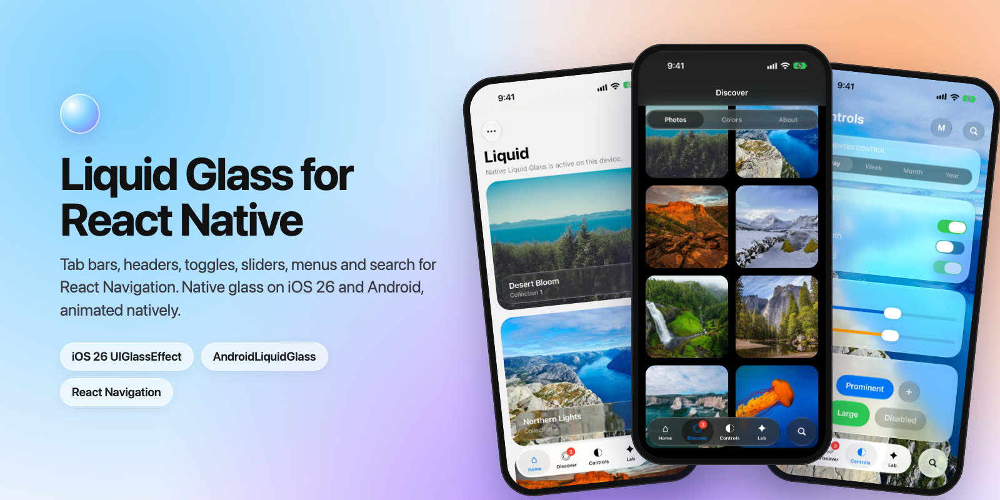

Liquid Glass UI components for React Native, built to drop into React Navigation as custom tab bars and headers.

- **iOS 26+** uses the native Liquid Glass material (`UIGlassEffect`, `UIGlassContainerEffect`). Earlier iOS versions fall back to a system material blur.
- **Android 12+** draws the glass with Jetpack Compose effects, built on code vendored from [AndroidLiquidGlass](https://github.com/Kyant0/AndroidLiquidGlass) by Kyant (Apache 2.0, no extra dependency), to blur, saturate and refract the React Native views behind the glass. Lens refraction needs Android 13+. Earlier Android versions get a frosted, opaque material.
- New Architecture (Fabric) only.
- Every animation (the tab bar drop, morphs, toggles, sliders) runs natively, not on the JS thread.

**Documentation: https://mohamedabdelnaby.github.io/liquid/** (every prop, GIFs, light and dark screenshots). For copy-paste recipes of every component, see [`USAGE.md`](USAGE.md) (it ships with the package).

## Preview

| Bottom tab bar | Top tab bar | Controls |
| --- | --- | --- |
| 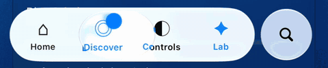 | 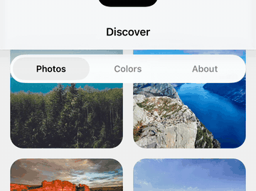 | 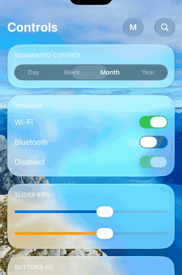 |
| **Tab bar search** | **Toolbar morph and menu** | **Light and dark** |
| 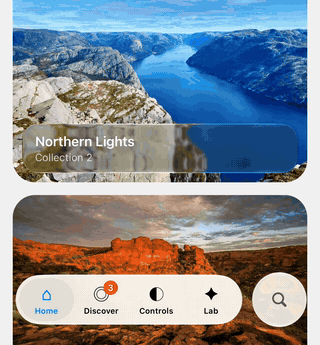 | 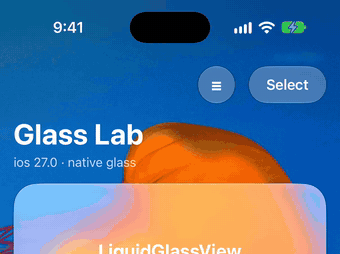 | 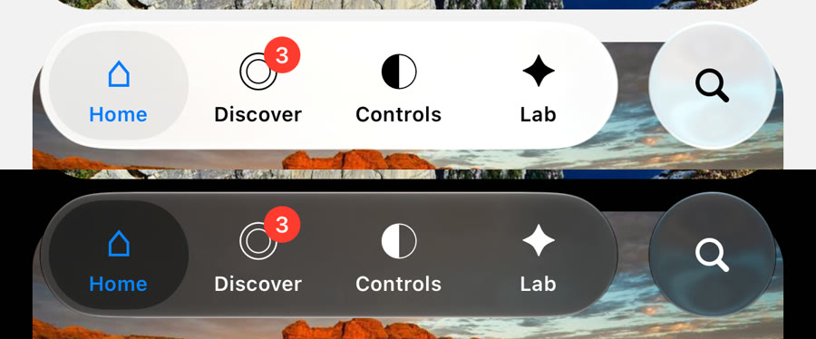 |

| Home | Discover | Controls | Lab |
| --- | --- | --- | --- |
| 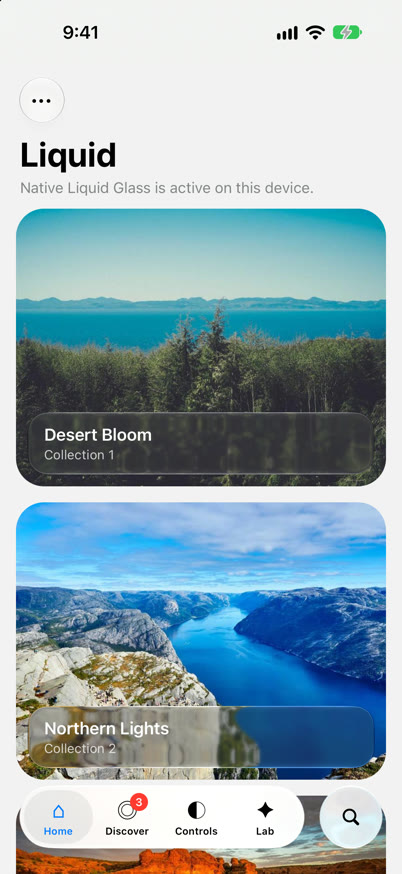 | 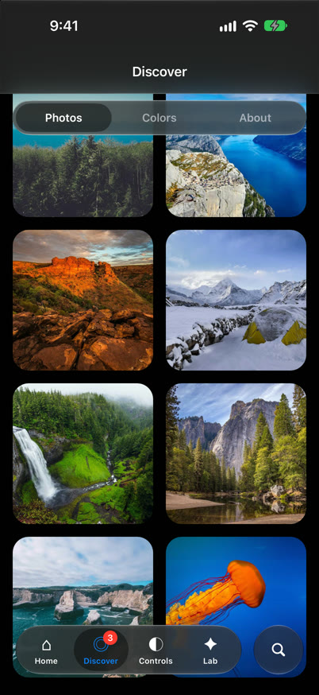 | 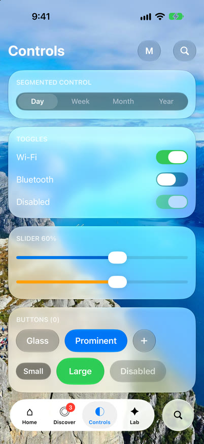 | 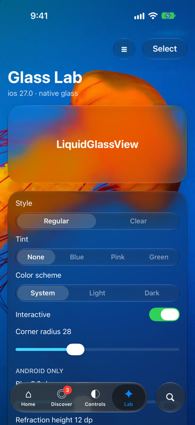 |

## Components

| Component | Use |
| --- | --- |
| `LiquidGlassView` | The glass material as a view. Children render on top. |
| `LiquidGlassContainer` | Groups glass views so they merge and morph together (iOS 26). |
| `LiquidBottomTabBar` | Floating glass tab bar for `@react-navigation/bottom-tabs`, with a liquid drop and an optional search. |
| `LiquidTopTabBar` | Floating segmented glass bar for `@react-navigation/material-top-tabs`. |
| `LiquidHeader` | Glass header for native-stack, stack, bottom-tabs and drawer navigators. |
| `LiquidButton`, `LiquidIconButton` | Glass and tinted (`prominent`) buttons that bulge when pressed. |
| `LiquidToggle` | iOS 26 style switch whose thumb turns into glass while pressed. |
| `LiquidSlider` | Slider with a glass thumb while dragging. |
| `LiquidSegmentedControl` | Glass segmented control with a sliding selection pill. |
| `LiquidSearchBar` | Glass search field. |
| `LiquidExpandableSearch` | Round search button that morphs into a field with a close button. |
| `LiquidMenu` | Glass button that morphs into a menu, with submenus. |

## Installation

```sh
yarn add @mohamed_abd_elnaby/react-native-liquid react-native-safe-area-context
```

For the navigation components, install the navigators you use (`@react-navigation/bottom-tabs`, `@react-navigation/material-top-tabs`, `@react-navigation/native-stack`, ...).

Then rebuild the native app (`npx pod-install`, or `npx expo prebuild` / `npx expo run:ios` with Expo). The package does not work in Expo Go.

### Requirements

- React Native 0.80+ with the New Architecture enabled.
- iOS: build with Xcode 26 or later to get Liquid Glass on iOS 26 devices.
- Android: Kotlin 2.2+ in the app. The library applies the Compose compiler plugin that matches the app's `kotlinVersion`.

## Usage

### Bottom tabs

```tsx
import { createBottomTabNavigator } from '@react-navigation/bottom-tabs';
import { LiquidBottomTabBar } from '@mohamed_abd_elnaby/react-native-liquid';

const Tab = createBottomTabNavigator();

export function Tabs() {
  return (
    <Tab.Navigator tabBar={(props) => <LiquidBottomTabBar {...props} />}>
      <Tab.Screen
        name="Home"
        component={HomeScreen}
        options={{ tabBarIcon: ({ color }) => <HomeIcon color={color} /> }}
      />
      <Tab.Screen name="Settings" component={SettingsScreen} />
    </Tab.Navigator>
  );
}
```

Pressing lifts a glass drop out of the selection pill. It follows the finger, stretches with its speed, magnifies the tabs and melts back into the pill. In light mode the bar is frosted white with a soft gray pill; in dark mode it is frosted dark gray with a darker pill.

The bar floats over the screens, so pad scrollable content with `useBottomTabBarHeight()` from `@react-navigation/bottom-tabs` (the bar reports its height to it).

It reads `tabBarIcon`, `tabBarLabel`, `tabBarShowLabel`, `tabBarBadge`, `tabBarBadgeStyle`, `tabBarActiveTintColor`, `tabBarInactiveTintColor`, `tabBarLabelStyle`, `tabBarAccessibilityLabel`, `tabBarButtonTestID`, `tabBarHideOnKeyboard` and `tabBarStyle: { display: 'none' }`, and emits `tabPress` / `tabLongPress`.

Extra props:

| Prop | Default | Description |
| --- | --- | --- |
| `search` | | Adds a search button after the bar that morphs into a field with a close button. The tabs fade out and the bar rises above the keyboard. Takes `placeholder`, `value`, `onChangeText`, `onSubmit`, `expanded`, `defaultExpanded` and `onExpandedChange`. Replaces `accessory`. |
| `accessory` | | Element in a separate glass circle after the bar. Wrap it in a `Pressable`. |
| `glassStyle` | `'clear'` | `'regular'` or `'clear'`. |
| `glassTintColor` | theme frost | Tints the glass. Defaults to `colors.tabBarGlass`. |
| `blur` | `0.8` | Frosts the content under the bar, from 0 (clear) to 1. |
| `selectionColor` | theme pill | Color of the resting pill behind the focused tab. |
| `activeTintColor` / `inactiveTintColor` | | Override the screen options. |
| `lens` | `true` | Lifts the liquid drop while pressing and dragging. |
| `colorScheme` | `'system'` | `'system'`, `'light'` or `'dark'`. |
| `height` | `62` | Height of the capsule. |
| `horizontalMargin` | `20` | Distance from the screen edges. |
| `bottomOffset` | safe area | Distance from the bottom edge. |
| `style` | | Style of the capsule. |

Use `createLiquidBottomTabBar(options)` to create the `tabBar` function once, outside of render:

```tsx
const tabBar = createLiquidBottomTabBar({ search: { placeholder: 'Search' } });

<Tab.Navigator tabBar={tabBar}>
```

### Top tabs

```tsx
import { createMaterialTopTabNavigator } from '@react-navigation/material-top-tabs';
import {
  createLiquidTopTabBar,
  LIQUID_TOP_TAB_BAR_HEIGHT,
} from '@mohamed_abd_elnaby/react-native-liquid';

const TopTab = createMaterialTopTabNavigator();
const tabBar = createLiquidTopTabBar();

<TopTab.Navigator tabBar={tabBar}>
  <TopTab.Screen name="Photos" component={Photos} />
  <TopTab.Screen name="Albums" component={Albums} />
</TopTab.Navigator>;
```

The bar has the same drop and frosted look as the bottom bar. While swiping pages, the pill and the label colors follow the pager position natively.

The bar floats over the pages, so pad their content with `LIQUID_TOP_TAB_BAR_HEIGHT` (60), e.g. `contentContainerStyle={{ paddingTop: LIQUID_TOP_TAB_BAR_HEIGHT }}`.

| Option | Default | Description |
| --- | --- | --- |
| `floating` | `true` | Floats the bar over the pages so content scrolls under the glass. |
| `glassStyle` | `'clear'` | `'regular'` or `'clear'`. |
| `glassTintColor` | theme frost | Same frost as the bottom tab bar by default. |
| `blur` | `0.8` | Frosts the content under the bar, from 0 to 1. |
| `selectionColor` | theme pill | Color of the pill behind the focused tab. |
| `lensTintColor` | theme | Tints the glass of the drop. |
| `activeTintColor` / `inactiveTintColor` | | Override the screen options. The drop uses the active color too. |
| `lens` | `true` | Lifts the drop while pressing. |
| `colorScheme` | `'system'` | Forces light or dark. |
| `height` | `44` | Height of the capsule. |
| `style` / `containerStyle` | | Style of the capsule / of the view around it. |

### Header

```tsx
import { createNativeStackNavigator } from '@react-navigation/native-stack';
import { createLiquidHeader } from '@mohamed_abd_elnaby/react-native-liquid';

const Stack = createNativeStackNavigator();
const header = createLiquidHeader(); // or createLiquidHeader({ variant: 'bar' })

<Stack.Navigator screenOptions={{ header, headerTransparent: true }}>
  ...
</Stack.Navigator>;
```

- `variant: 'floating'` (default) draws separate glass controls over the content, like iOS 26: a round glass back button, the title, and `headerRight` inside a glass capsule.
- `variant: 'bar'` draws a full-width glass bar.

With `headerTransparent: true` the content scrolls under the glass. Pad it with `useLiquidHeaderHeight()`.

It reads `title`, `headerTitle`, `headerTitleAlign`, `headerTitleStyle`, `headerTintColor`, `headerLeft`, `headerRight` and `headerBackTitle`. `<LiquidHeader {...props} />` works too.

### Glass view

```tsx
import { LiquidGlassView, LiquidGlassContainer } from '@mohamed_abd_elnaby/react-native-liquid';

<LiquidGlassView style={{ borderRadius: 24, padding: 16 }}>
  <Text>On glass</Text>
</LiquidGlassView>

<LiquidGlassContainer spacing={8} style={{ flexDirection: 'row', gap: 16 }}>
  <LiquidGlassView morph interactive cornerRadius={22} style={{ width: wide ? 104 : 44, height: 44 }} />
  <LiquidGlassView morph interactive cornerRadius={22} style={{ width: 44, height: 44 }} />
</LiquidGlassContainer>
```

Keep a container's `spacing` below the gap between its children: the shapes then fuse only while they morph and rest apart.

| Prop | Default | Description |
| --- | --- | --- |
| `glassStyle` | `'regular'` | `'regular'` or `'clear'` (more transparent, for media). |
| `tintColor` | | Tints the glass. |
| `interactive` | `false` | Native interactive glass on iOS 26. Press highlight on Android. |
| `cornerRadius` | `style.borderRadius` | Values above half of the shortest side make a capsule. |
| `morph` | `false` | Animates size and position changes as a liquid morph. |
| `colorScheme` | `'system'` | Forces the light or dark material. |
| `blurRadius` | `8` (`clear`: `2`) | Android: backdrop blur in dp. |
| `refractionHeight` / `refractionAmount` | `12` / `24` | Android 13+: lens refraction in dp. |
| `chromaticAberration`, `depthEffect` | `false` | Android 13+: lens options. |
| `highlight`, `shadow` | `true` | Android: rim highlight and drop shadow. |

### Controls

```tsx
<LiquidButton title="Continue" variant="prominent" onPress={next} />
<LiquidIconButton accessibilityLabel="Add" onPress={add}><PlusIcon /></LiquidIconButton>
<LiquidToggle value={enabled} onValueChange={setEnabled} />
<LiquidToggle value={on} onValueChange={setOn} onTintColor="#FF3B30" offTintColor="#3A3A3C" thumbTintColor="#FFFFFF" lensTintColor="rgba(255,59,48,0.12)" />
<LiquidSlider value={volume} onValueChange={setVolume} step={0.1} />
<LiquidSegmentedControl segments={['Day', 'Week', 'Month']} selectedIndex={i} onChange={setI} />
<LiquidSearchBar value={query} onChangeText={setQuery} />
<LiquidExpandableSearch value={query} onChangeText={setQuery} placeholder="Search">
  <Text>Title shown next to the button while collapsed</Text>
</LiquidExpandableSearch>
<LiquidMenu
  items={[
    { title: 'Share', systemImage: 'square.and.arrow.up', onPress: share },
    { title: 'Delete', systemImage: 'trash', destructive: true },
  ]}
>
  <Text>•••</Text>
</LiquidMenu>
```

`LiquidMenu` morphs into the system menu on iOS and into a glass panel on Android. Items take `title`, `subtitle`, `systemImage` (iOS), `destructive`, `disabled`, `checked`, `onPress` and `children` (a submenu). Use `bare` to place the trigger inside another glass shape.

### Utilities

- `isLiquidGlassSupported`: `true` on iOS 26+ and Android 12+.
- `useLiquidColors(colorScheme?)`: the scheme and the palette used by the components (`label`, `secondaryLabel`, `tint`, `success`, `selection`, `tabSelection`, `tabBarGlass`, `topTabLens`, `track`, `thumb`).
- `getLiquidColors(scheme)` and `useLiquidColorScheme(setting)` for use outside components.

## How the Android glass works

The glass draws a backdrop with Compose effects (vibrancy, blur, lens). Each `LiquidGlassView` hosts a small `ComposeView` behind its React children, and feeds it a custom `Backdrop` that records the views drawn *behind* the glass into a `RenderNode` before every frame. Re-recording that node refreshes the glass without recomposing, so scrolling content stays smooth under tab bars and headers.

Limitations:

- Content rendered in a separate surface (`SurfaceView`, some video and map views) is not sampled.
- Glass shapes do not merge on Android. `LiquidGlassContainer` is a regular view there.

## Example app

The `example` folder is an Expo app with a native stack, bottom tabs, top tabs and a controls screen.

```sh
yarn
yarn example expo prebuild
yarn example ios     # or: yarn example android
```

## Contributing

See [CONTRIBUTING.md](CONTRIBUTING.md).

## License

MIT. The vendored AndroidLiquidGlass code is Apache 2.0, see [THIRD_PARTY_NOTICES.md](THIRD_PARTY_NOTICES.md).
