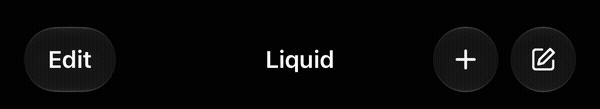
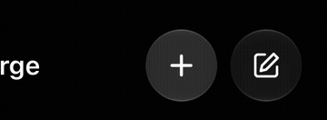
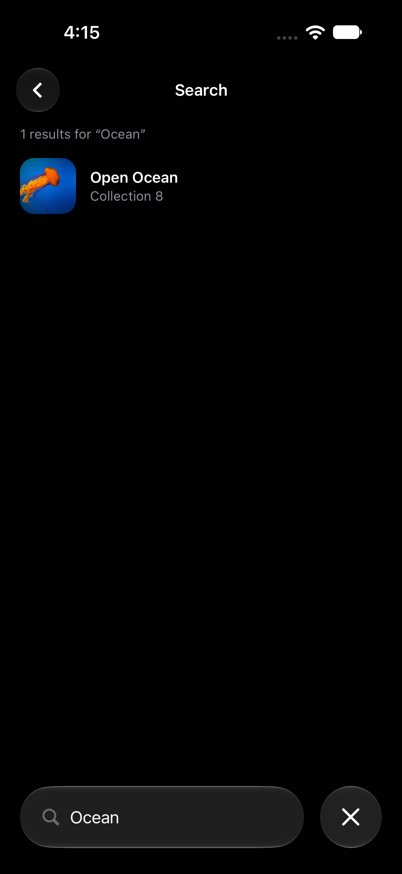
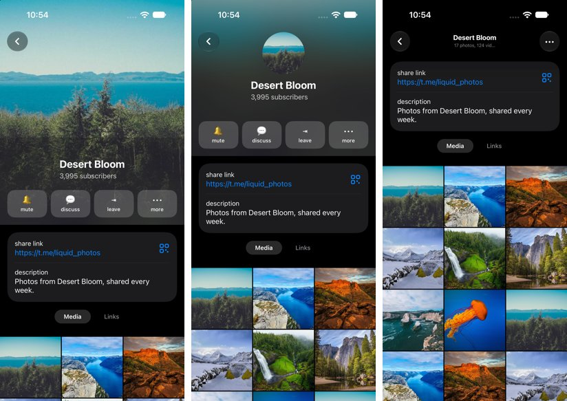

# @mohamed_abd_elnaby/react-native-liquid

[](https://www.npmjs.com/package/@mohamed_abd_elnaby/react-native-liquid)
[](LICENSE)


Liquid Glass UI components for React Native, built to drop into React Navigation as custom tab bars and headers. Everything you need for iOS 26 style screens: a tab bar with Apple's liquid lens, one floating header whose buttons morph and merge between screens, search fields that grow out of their buttons, and a profile header that collapses as you scroll.

**Highlights**

- Apple's own Liquid Glass lens in the iOS 26 tab bar, and a matching liquid drop on Android.
- One shared header for the whole app: Edit becomes Sort or the back button, two circles fuse into one, titles blur across, on every push, pop and tab switch.
- Buttons that change content morph: `Mute → Unmute` blurs across while the glass resizes.
- Search everywhere: a field under the header that rises into it, a header circle that stretches into a field, and a tab bar search that opens a search screen.
- A channel profile header: full photo, round avatar, then a frosted glass bar.
- Light and dark mode, left-to-right and right-to-left, iOS and Android.

- **iOS 26+** uses the native Liquid Glass material (`UIGlassEffect`, `UIGlassContainerEffect`). Earlier iOS versions fall back to a system material blur.
- **Android 12+** draws the glass natively with Jetpack Compose: it blurs, saturates and refracts the React Native views behind the glass. The glass code ships inside this package, so there is **no extra dependency** to install. Lens refraction needs Android 13+. Earlier Android versions get a frosted, opaque material.
- New Architecture (Fabric) only.
- Every animation (the tab bar drop, morphs, toggles, sliders) runs natively, not on the JS thread.

**Documentation: https://mohamedabdelnaby.github.io/liquid/** (every prop, GIFs, light and dark screenshots). For copy-paste recipes of every component, see [`USAGE.md`](USAGE.md). Using an AI coding agent? Point it at [`CONTEXT.md`](CONTEXT.md): it explains how the pieces fit together to build these screens in any app. Both ship with the package.

## Preview

| Bottom tab bar | Top tab bar | Controls |
| --- | --- | --- |
|  |  |  |
| **Tab bar search** | **Toolbar morph and menu** | **Light and dark** |
|  |  |  |

| **Header morph between tabs** | **Merge into the pressed button** | **Tab bar search screen** |
|  |  |  |



| Home | Discover | Controls | Lab |
| --- | --- | --- | --- |
|  |  |  |  |

## Components

| Component | Use |
| --- | --- |
| `LiquidGlassView` | The glass material as a view. Children render on top. |
| `LiquidGlassContainer` | Groups glass views so they merge and morph together (iOS 26). |
| `LiquidBottomTabBar` | Floating glass tab bar for `@react-navigation/bottom-tabs`, with a liquid drop and an optional search. |
| `LiquidTopTabBar` | Floating segmented glass bar for `@react-navigation/material-top-tabs`. |
| `LiquidHeader` | Glass header for native-stack, stack, bottom-tabs and drawer navigators. |
| `LiquidHeaderProvider`, `useLiquidNavigationHeader` | One floating header over a navigator whose glass buttons morph and merge between screens (Edit → back, two circles → one). |
| `LiquidProfileHeader` | Profile header with a photo hero that turns into a round avatar, then a glass bar, as you scroll. |
| `LiquidStickyView` | Scrolls with the content, then stays under a header. |
| `LiquidButton`, `LiquidIconButton` | Glass and tinted (`prominent`) buttons that bulge when pressed. |
| `LiquidToggle` | iOS 26 style switch whose thumb turns into glass while pressed. |
| `LiquidSlider` | Slider with a glass thumb while dragging. |
| `LiquidSegmentedControl` | Glass segmented control with a sliding selection pill. |
| `LiquidSearchBar` | Glass search field. |
| `LiquidExpandableSearch` | Round search button that morphs into a field with a close button. |
| `LiquidSearchHeader` | Header row with a search field under it that rises into the row. |
| `LiquidMenu` | Glass button that morphs into a menu, with submenus. |

## Quick start

```tsx
const tabBar = createLiquidBottomTabBar({ search: { route: 'Search' } });

<LiquidHeaderProvider>
  <Stack.Navigator screenOptions={{ headerShown: false }}>
    <Stack.Screen name="Tabs" component={Tabs} />
  </Stack.Navigator>
</LiquidHeaderProvider>

// In any screen:
useLiquidNavigationHeader(navigation, {
  title: 'Chats',
  left: { title: 'Edit', onPress: edit },
  right: [{ key: 'compose', icon: <ComposeIcon />, onPress: compose }],
});
```

See [CONTEXT.md](CONTEXT.md) for the full app shell.

## Installation

```sh
yarn add @mohamed_abd_elnaby/react-native-liquid react-native-safe-area-context
```

For the navigation components, install the navigators you use (`@react-navigation/bottom-tabs`, `@react-navigation/material-top-tabs`, `@react-navigation/native-stack`, ...).

Then rebuild the native app (`npx pod-install`, or `npx expo prebuild` / `npx expo run:ios` with Expo). The package does not work in Expo Go.

### Requirements

- React Native 0.80+ with the New Architecture enabled.
- iOS: build with Xcode 26 or later to get Liquid Glass on iOS 26 devices.
- Android: Kotlin 2.2+ in the app. The library applies the Compose compiler plugin that matches the app's `kotlinVersion`.

## Usage

### Bottom tabs

```tsx
import { createBottomTabNavigator } from '@react-navigation/bottom-tabs';
import { LiquidBottomTabBar } from '@mohamed_abd_elnaby/react-native-liquid';

const Tab = createBottomTabNavigator();

export function Tabs() {
  return (
    <Tab.Navigator tabBar={(props) => <LiquidBottomTabBar {...props} />}>
      <Tab.Screen
        name="Home"
        component={HomeScreen}
        options={{ tabBarIcon: ({ color }) => <HomeIcon color={color} /> }}
      />
      <Tab.Screen name="Settings" component={SettingsScreen} />
    </Tab.Navigator>
  );
}
```

Pressing lifts a glass drop out of the selection pill. It follows the finger, stretches with its speed, magnifies the tabs and melts back into the pill. In light mode the bar is frosted white with a soft gray pill; in dark mode it is frosted dark gray with a darker pill.

The bar floats over the screens, so pad scrollable content with `useBottomTabBarHeight()` from `@react-navigation/bottom-tabs` (the bar reports its height to it).

It reads `tabBarIcon`, `tabBarLabel`, `tabBarShowLabel`, `tabBarBadge`, `tabBarBadgeStyle`, `tabBarActiveTintColor`, `tabBarInactiveTintColor`, `tabBarLabelStyle`, `tabBarAccessibilityLabel`, `tabBarButtonTestID`, `tabBarHideOnKeyboard` and `tabBarStyle: { display: 'none' }`, and emits `tabPress` / `tabLongPress`.

Extra props:

| Prop | Default | Description |
| --- | --- | --- |
| `search` | | Adds a search button after the bar that morphs into a field with a close button. The tabs fade out and the bar rises above the keyboard. Takes `placeholder`, `value`, `onChangeText`, `onSubmit`, `expanded`, `defaultExpanded`, `onExpandedChange` and `route`. With `route`, that tab screen (it gets no tab item) is shown while searching and receives the text as `route.params.query`; closing returns to the previous tab. Replaces `accessory`. |
| `accessory` | | Element in a separate glass circle after the bar. Wrap it in a `Pressable`. |
| `glassStyle` | `'clear'` | `'regular'` or `'clear'`. |
| `glassTintColor` | theme frost | Tints the glass. Defaults to `colors.tabBarGlass`. |
| `blur` | `0.8` | Frosts the content under the bar, from 0 (clear) to 1. |
| `selectionColor` | theme pill | Color of the resting pill behind the focused tab. |
| `activeTintColor` / `inactiveTintColor` | | Override the screen options. |
| `lens` | `true` | Lifts the liquid drop while pressing and dragging. |
| `colorScheme` | `'system'` | `'system'`, `'light'` or `'dark'`. |
| `height` | `62` | Height of the capsule. |
| `horizontalMargin` | `20` | Distance from the screen edges. |
| `bottomOffset` | safe area | Distance from the bottom edge. |
| `style` | | Style of the capsule. |

Use `createLiquidBottomTabBar(options)` to create the `tabBar` function once, outside of render:

```tsx
const tabBar = createLiquidBottomTabBar({ search: { placeholder: 'Search' } });

<Tab.Navigator tabBar={tabBar}>
```

### Top tabs

```tsx
import { createMaterialTopTabNavigator } from '@react-navigation/material-top-tabs';
import {
  createLiquidTopTabBar,
  LIQUID_TOP_TAB_BAR_HEIGHT,
} from '@mohamed_abd_elnaby/react-native-liquid';

const TopTab = createMaterialTopTabNavigator();
const tabBar = createLiquidTopTabBar();

<TopTab.Navigator tabBar={tabBar}>
  <TopTab.Screen name="Photos" component={Photos} />
  <TopTab.Screen name="Albums" component={Albums} />
</TopTab.Navigator>;
```

The bar has the same drop and frosted look as the bottom bar. While swiping pages, the pill and the label colors follow the pager position natively.

The bar floats over the pages, so pad their content with `LIQUID_TOP_TAB_BAR_HEIGHT` (60), e.g. `contentContainerStyle={{ paddingTop: LIQUID_TOP_TAB_BAR_HEIGHT }}`.

| Option | Default | Description |
| --- | --- | --- |
| `floating` | `true` | Floats the bar over the pages so content scrolls under the glass. |
| `glassStyle` | `'clear'` | `'regular'` or `'clear'`. |
| `glassTintColor` | theme frost | Same frost as the bottom tab bar by default. |
| `blur` | `0.8` | Frosts the content under the bar, from 0 to 1. |
| `selectionColor` | theme pill | Color of the pill behind the focused tab. |
| `lensTintColor` | theme | Tints the glass of the drop. |
| `activeTintColor` / `inactiveTintColor` | | Override the screen options. The drop uses the active color too. |
| `lens` | `true` | Lifts the drop while pressing. |
| `colorScheme` | `'system'` | Forces light or dark. |
| `height` | `44` | Height of the capsule. |
| `style` / `containerStyle` | | Style of the capsule / of the view around it. |

### Header

```tsx
import { createNativeStackNavigator } from '@react-navigation/native-stack';
import { createLiquidHeader } from '@mohamed_abd_elnaby/react-native-liquid';

const Stack = createNativeStackNavigator();
const header = createLiquidHeader(); // or createLiquidHeader({ variant: 'bar' })

<Stack.Navigator screenOptions={{ header, headerTransparent: true }}>
  ...
</Stack.Navigator>;
```

- `variant: 'floating'` (default) draws separate glass controls over the content, like iOS 26: a round glass back button, the title, and `headerRight` inside a glass capsule.
- `variant: 'bar'` draws a full-width glass bar.

With `headerTransparent: true` the content scrolls under the glass. Pad it with `useLiquidHeaderHeight()`.

It reads `title`, `headerTitle`, `headerTitleAlign`, `headerTitleStyle`, `headerTintColor`, `headerLeft`, `headerRight` and `headerBackTitle`. `<LiquidHeader {...props} />` works too.

### Morphing header

One floating header for the whole app, drawn by `LiquidHeaderProvider` around your root navigator. Each screen describes its header with `useLiquidNavigationHeader`; turn off the navigators' own headers. Because the header is shared, it morphs on every push, pop and tab switch.

```tsx
useLiquidNavigationHeader(navigation, {
  title: 'Chats',
  subtitle: undefined,            // with a subtitle the title shows in a glass capsule
  left: { title: editing ? 'Done' : 'Edit', onPress: toggle },
  right: [
    { key: 'story', icon: <PlusIcon />, onPress: () => setPressed('story') },
    { key: 'compose', icon: <ComposeIcon />, tintColor: '#0A84FF' },
  ],
  search: undefined,              // { value, onChangeText }: a circle that becomes a field
});
```

- Items in the same place morph when their `key` changes: the glass resizes and the content blurs across.
- Fewer items: the extra ones slide into their neighbour and fuse. Use `null` to keep a place empty, e.g. `right: [closeButton, null]` merges the second button into the first one, which you pressed.
- `stretch: true` makes an item take the free width.
- The back button appears in stacks, not in tabs (`backButton` overrides it).

### Search header

`LiquidSearchHeader` is a full-width field under a header row that rises into it, like a contacts list on iOS 26. Put it under the shared header with `headerHeight={LIQUID_HEADER_HEIGHT}`, clear the header while searching, and hide the tab bar with `tabBarStyle: { display: 'none' }`.

### Profile header

`LiquidProfileHeader` follows an `Animated.ScrollView`: a full-width photo, then a round avatar over the blurred photo, then a frosted glass bar with the name. Use `useLiquidProfileSnapOffsets()` for the rest positions and `useLiquidProfileEntrance()` to grow the photo out of the chat header's avatar. `LiquidStickyView` pins a control under the bar.

### Right to left

Everything follows `I18nManager.isRTL`: the tab bars fill from the right, search fields and headers mirror, merges slide the other way and switches and sliders flip. Call `I18nManager.forceRTL(true)` and restart the app.

### Glass view

```tsx
import { LiquidGlassView, LiquidGlassContainer } from '@mohamed_abd_elnaby/react-native-liquid';

<LiquidGlassView style={{ borderRadius: 24, padding: 16 }}>
  <Text>On glass</Text>
</LiquidGlassView>

<LiquidGlassContainer spacing={8} style={{ flexDirection: 'row', gap: 16 }}>
  <LiquidGlassView morph interactive cornerRadius={22} style={{ width: wide ? 104 : 44, height: 44 }} />
  <LiquidGlassView morph interactive cornerRadius={22} style={{ width: 44, height: 44 }} />
</LiquidGlassContainer>
```

Keep a container's `spacing` below the gap between its children: the shapes then fuse only while they morph and rest apart.

| Prop | Default | Description |
| --- | --- | --- |
| `glassStyle` | `'regular'` | `'regular'` or `'clear'` (more transparent, for media). |
| `tintColor` | | Tints the glass. |
| `interactive` | `false` | Native interactive glass on iOS 26. Press highlight on Android. |
| `cornerRadius` | `style.borderRadius` | Values above half of the shortest side make a capsule. |
| `morph` | `false` | Animates size and position changes as a liquid morph, and blurs content across when the children change. |
| `fadeBottom` | `0` | iOS: fades the glass out over this many points at its bottom edge. |
| `colorScheme` | `'system'` | Forces the light or dark material. |
| `blurRadius` | `8` (`clear`: `2`) | Android: backdrop blur in dp. |
| `refractionHeight` / `refractionAmount` | `12` / `24` | Android 13+: lens refraction in dp. |
| `chromaticAberration`, `depthEffect` | `false` | Android 13+: lens options. |
| `highlight`, `shadow` | `true` | Android: rim highlight and drop shadow. |

### Controls

```tsx
<LiquidButton title="Continue" variant="prominent" onPress={next} />
<LiquidButton morph title={muted ? 'Unmute' : 'Mute'} onPress={toggleMute} />
<LiquidIconButton accessibilityLabel="Add" onPress={add}><PlusIcon /></LiquidIconButton>
<LiquidToggle value={enabled} onValueChange={setEnabled} />
<LiquidToggle value={on} onValueChange={setOn} onTintColor="#FF3B30" offTintColor="#3A3A3C" thumbTintColor="#FFFFFF" lensTintColor="rgba(255,59,48,0.12)" />
<LiquidSlider value={volume} onValueChange={setVolume} step={0.1} />
<LiquidSegmentedControl segments={['Day', 'Week', 'Month']} selectedIndex={i} onChange={setI} />
<LiquidSearchBar value={query} onChangeText={setQuery} />
<LiquidExpandableSearch value={query} onChangeText={setQuery} placeholder="Search">
  <Text>Title shown next to the button while collapsed</Text>
</LiquidExpandableSearch>
<LiquidMenu
  items={[
    { title: 'Share', systemImage: 'square.and.arrow.up', onPress: share },
    { title: 'Delete', systemImage: 'trash', destructive: true },
  ]}
>
  <Text>•••</Text>
</LiquidMenu>
```

`LiquidMenu` morphs into the system menu on iOS and into a glass panel on Android. Items take `title`, `subtitle`, `systemImage` (iOS), `destructive`, `disabled`, `checked`, `onPress` and `children` (a submenu). Use `bare` to place the trigger inside another glass shape.

### Utilities

- `isLiquidGlassSupported`: `true` on iOS 26+ and Android 12+.
- `useLiquidColors(colorScheme?)`: the scheme and the palette used by the components (`label`, `secondaryLabel`, `tint`, `success`, `selection`, `tabSelection`, `tabBarGlass`, `topTabLens`, `track`, `thumb`).
- `getLiquidColors(scheme)` and `useLiquidColorScheme(setting)` for use outside components.

## How the Android glass works

The glass draws a backdrop with Compose effects (vibrancy, blur, lens). Each `LiquidGlassView` hosts a small `ComposeView` behind its React children, and feeds it a custom `Backdrop` that records the views drawn *behind* the glass into a `RenderNode` before every frame. Re-recording that node refreshes the glass without recomposing, so scrolling content stays smooth under tab bars and headers.

Limitations:

- Content rendered in a separate surface (`SurfaceView`, some video and map views) is not sampled.
- Glass shapes do not merge on Android. `LiquidGlassContainer` is a regular view there.

The glass effects (blur, vibrancy, lens, highlight, shadows) are adapted from [AndroidLiquidGlass](https://github.com/Kyant0/AndroidLiquidGlass) by Kyant and included in the package under its Apache 2.0 license. See [THIRD_PARTY_NOTICES.md](THIRD_PARTY_NOTICES.md).

## Example app

The `example` folder is a React Native CLI app in the iOS 26 style: Contacts with a search header, Chats with Edit and merging buttons, a chat screen and channel profile, a Settings-style header search, a tab bar search screen, top tabs, controls, a glass lab, and light/dark and LTR/RTL switches. It installs the published package from npm.

```sh
cd example
npm install
cd ios && pod install && cd ..
npm run ios       # or: npm run android
```

## Contributing

See [CONTRIBUTING.md](CONTRIBUTING.md).

## License

MIT. The vendored AndroidLiquidGlass code is Apache 2.0, see [THIRD_PARTY_NOTICES.md](THIRD_PARTY_NOTICES.md).
